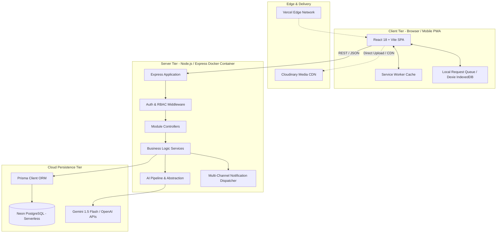
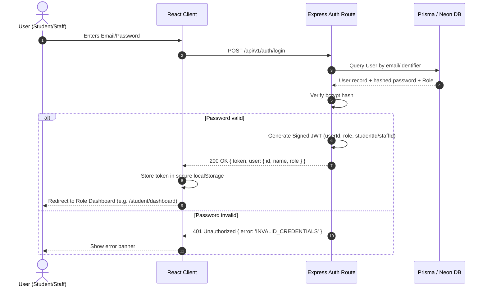
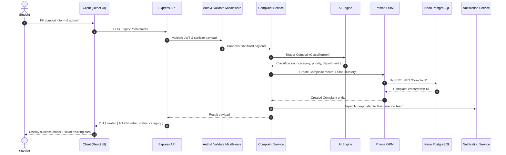
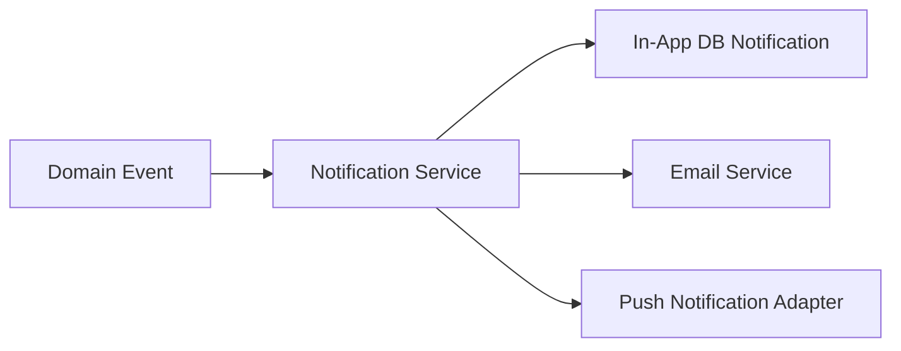
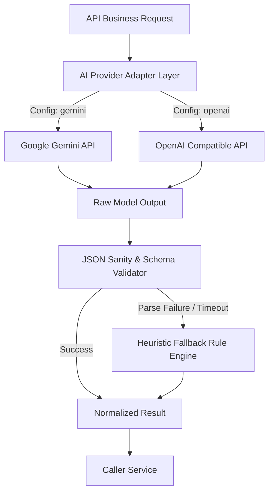
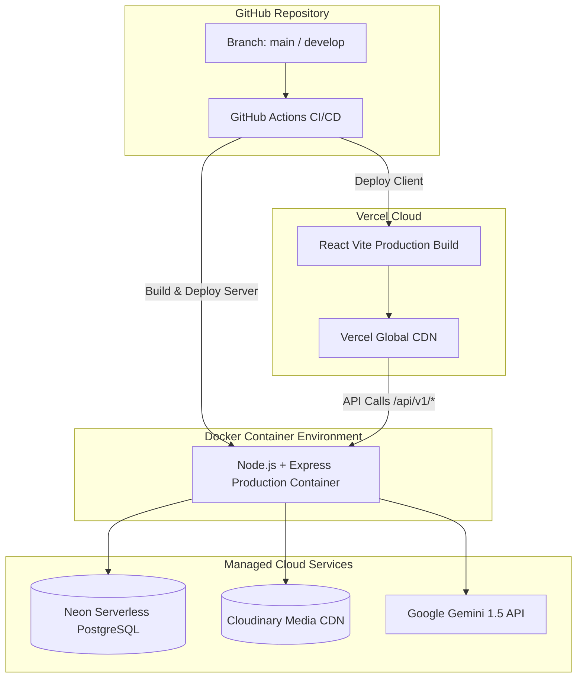

# 03 - SYSTEM ARCHITECTURE SPECIFICATION

## 1. Architectural Style & Philosophy
**Campus Life, Debugged** is designed around a **Modular Full-Stack Layered Architecture** with strict separation of concerns, stateless RESTful services, and robust data persistence.

```text
React 18 + Vite (SPA / PWA)
           │
           │  HTTPS / REST / JSON + Bearer JWT
           ▼
API Gateway / Express Application
           │
  ┌────────┴──────────────────────────┐
  │ Middleware Pipeline               │
  │ (Helmet, CORS, RateLimit, AuthZ)  │
  └────────┬──────────────────────────┘
           ▼
Express Controllers (Route Handlers)
           │
           ▼
Business Logic Service Layer (Services)
      ┌────┴──────────────────────────┐
      │                               │
      ▼                               ▼
Prisma ORM Layer             AI Service Layer
      │                      (Gemini / OpenAI Adapter)
      ▼                               │
Neon PostgreSQL              Cloudinary File Storage
(Serverless PgBouncer Pool)
```

---

## 2. High-Level System Architecture Diagram



---

## 3. Frontend Architecture (React + Vite + JSX)
* **Single Page Application (SPA):** Built with React 18, Vite 5, JavaScript, and standard JSX.
* **Component Hierarchy:**
  * `components/ui`: Atomic elements (buttons, badges, inputs, modal dialogs, drawers).
  * `components/layout`: AppShell, responsive sidebar, top bar, bottom navigation for mobile.
  * `features/*`: Domain-specific business logic components (attendance charts, gate-pass QR displays, ticket timelines).
* **State Management:**
  * Authentication and role contexts managed via React Context (`AuthContext`).
  * Server-state caching and synchronization using lightweight custom fetch hooks with SWR-like caching or TanStack Query.
* **Routing:** `react-router-dom` v6 with declarative `ProtectedRoute` and `RoleBasedRoute` wrappers preventing unauthorized view rendering.
* **Styling:** Tailwind CSS with a clean, professional SaaS light-theme color palette.

---

## 4. Backend Architecture (Node.js + Express.js + JavaScript)
The server operates as a modular, decoupled REST API:
1. **Routing Layer (`/src/routes`):** Maps REST endpoints to controller methods and applies route-specific middleware (`authenticate`, `authorizeRole(['WARDEN', 'ADMIN'])`).
2. **Controller Layer (`/src/controllers`):** Validates request parameters via Zod/Joi schemas, sanitizes payloads, and hands off execution to services.
3. **Service Layer (`/src/services`):** Houses pure business logic, transactional orchestrations, SLA timers, and cross-module interactions.
4. **Data Access Layer (`/src/config/database.js`):** Singleton instance of `PrismaClient` connected to Neon PostgreSQL.
5. **AI Service Layer (`/src/ai`):** Decoupled adapters executing complaint classification, vector similarity, and chat completions.

---

## 5. Database Architecture (Neon PostgreSQL + Prisma)
* **Provider:** Neon Serverless PostgreSQL with pooling enabled (`pgbouncer=true`).
* **ORM:** Prisma ORM generating lightweight JavaScript queries without TypeScript runtime overhead.
* **Connection Pooling:** Scalable pool connections ensuring low-memory footprint inside Docker containers.
* **Integrity:** Enforces foreign keys, unique composite indexes (e.g., preventing duplicate attendance for a student on the same session), and database-level enum types.

---

## 6. Authentication & RBAC Architecture



### Authorization Pipeline:
* `authenticate`: Decodes incoming `Authorization: Bearer <JWT>` header, validates token signature and expiry, attaches user payload to `req.user`.
* `authorize(roles...)`: Compares `req.user.role` against permissible route roles. Rejects with 403 Forbidden if mismatched.

---

## 7. End-to-End Request Workflow



---

## 8. Notification System Architecture
The notification system follows an event-driven dispatcher model:
* **Event Producers:** Core services (e.g., `gatePassService.approve()`, `complaintService.updateStatus()`, `noticeService.broadcast()`).
* **Dispatcher (`NotificationService`):**
  1. Writes in-app notification records to the `Notification` table in Neon PostgreSQL.
  2. If student has push tokens enabled, queues FCM push notification.
  3. If urgent (e.g. overnight leave approval), dispatches email notification through SendGrid / Nodemailer.



---

## 9. AI Subsystem Architecture
The AI layer exposes a clean abstraction interface (`AIService`) allowing seamless hot-swapping between Google Gemini 1.5 and OpenAI models without altering business services.



---

## 10. Storage Architecture (Cloudinary / S3-Compatible)
* **Client Direct / Pre-signed Uploads:** Student complaints and maintenance repair photos are uploaded using secure multipart requests.
* **Asset Optimization:** Auto-transformation applied to resize images to max 1280px width, convert to WebP format, and enforce file size caps (< 5 MB).
* **Storage URLs:** Stored in the `Attachment` database table with mime-type, dimensions, and parent entity linkage.

---

## 11. PWA & Offline Architecture
To guarantee uninterrupted campus gate and help-desk operations even during intermittent internet connectivity:
* **Manifest (`manifest.json`):** Configures standalone display, campus icons, and theme color `#2563EB`.
* **Service Worker (`sw.js`):**
  * **Static Assets:** Cache-first strategy for JS, CSS, and font bundles.
  * **API Requests:** Network-first with IndexedDB fallback for read queries (e.g., student ID, timetable, today's menu).
* **Gate Verification Offline Cache:** Security devices pre-fetch today's approved gate passes every 30 minutes, enabling offline barcode/QR validation at physical gate checkpoints.
* **Offline Fallback Page (`offline.html`):** Clean UI informing the user of lost network connection with auto-reconnect listeners.

---

## 12. Deployment Architecture (Vercel + Docker)


