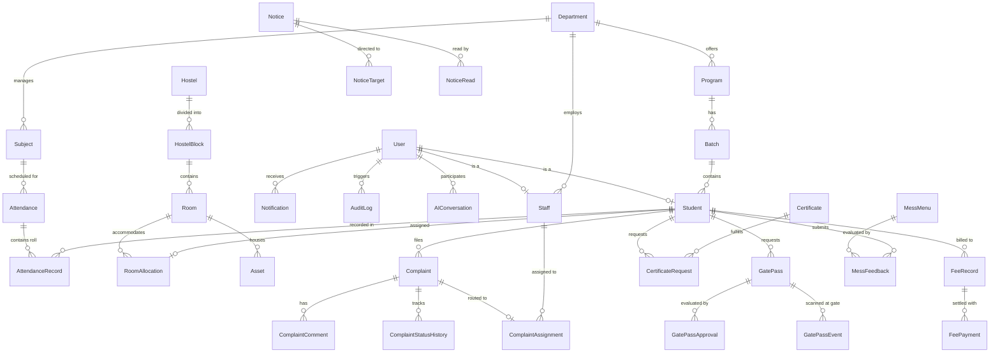

# 04 - DATABASE DESIGN & ENTITY SPECIFICATION

## 1. Database Philosophy & Technology Stack
* **Engine:** PostgreSQL 16 (Hosted on Neon Serverless)
* **Object-Relational Mapping (ORM):** Prisma ORM
* **Identifiers:** CUID / UUID string primary keys for distributed scalability and tamper-proof URLs.
* **Timestamps:** Every mutable entity includes `createdAt` and `updatedAt` with default `now()`.
* **Soft Deletions:** Critical entities support soft-deletion via `deletedAt DateTime?`.

---

## 2. Enums & Domain Constants

```prisma
enum Role {
  STUDENT
  FACULTY
  WARDEN
  MAINTENANCE
  SECURITY
  ACCOUNTS
  ADMIN
  SUPER_ADMIN
}

enum ComplaintStatus {
  SUBMITTED
  ASSIGNED
  IN_PROGRESS
  ON_HOLD
  RESOLVED
  CLOSED
  REJECTED
}

enum Priority {
  LOW
  MEDIUM
  HIGH
  URGENT
}

enum GatePassType {
  DAY_OUTING
  NIGHT_OUT
  EMERGENCY
  VACATION
}

enum GatePassStatus {
  PENDING
  APPROVED
  REJECTED
  CHECKED_OUT
  CHECKED_IN
  EXPIRED
}

enum LeaveStatus {
  PENDING
  RECOMMENDED
  APPROVED
  REJECTED
  CANCELLED
}

enum CertificateType {
  BONAFIDE
  STUDY
  CHARACTER
  FEE_ESTIMATE
  NO_OBJECTION
}

enum CertificateStatus {
  REQUESTED
  UNDER_REVIEW
  APPROVED
  GENERATED
  AVAILABLE
  REJECTED
}

enum FeeStatus {
  UNPAID
  PARTIALLY_PAID
  PAID
  OVERDUE
}

enum NoticeType {
  GENERAL
  ACADEMIC
  HOSTEL
  EXAMINATION
  EMERGENCY
}

enum MealType {
  BREAKFAST
  LUNCH
  SNACKS
  DINNER
}

enum GateEventType {
  CHECK_OUT
  CHECK_IN
}
```

---

## 3. Entity-Relationship Diagram (Mermaid)



---

## 4. Comprehensive Entity Dictionary

### 4.1 Core Identity & Organization

#### `User`
* **Purpose:** Central authentication record for every human interacting with the system.
* **Fields:**
  * `id`: String (cuid(), PK)
  * `email`: String (Unique)
  * `password`: String (bcrypt hash)
  * `role`: Role Enum
  * `firstName`: String
  * `lastName`: String
  * `phoneNumber`: String?
  * `avatarUrl`: String?
  * `isActive`: Boolean (Default: true)
  * `createdAt`: DateTime (now())
  * `updatedAt`: DateTime (updatedAt)
* **Relations:** 1:1 with `Student`, 1:1 with `Staff`, 1:N with `Notification`, `AuditLog`.
* **Indexes:** `idx_user_email`, `idx_user_role`.

#### `Student`
* **Purpose:** Academic, personal, and demographic metadata for enrolled learners.
* **Fields:**
  * `id`: String (cuid(), PK)
  * `userId`: String (Unique, FK -> User.id)
  * `rollNumber`: String (Unique)
  * `registrationNumber`: String (Unique)
  * `batchId`: String (FK -> Batch.id)
  * `departmentId`: String (FK -> Department.id)
  * `emergencyContact`: String
  * `bloodGroup`: String?
  * `guardianName`: String
  * `guardianPhone`: String
* **Indexes:** `idx_student_roll`, `idx_student_batch`.

#### `Staff`
* **Purpose:** Professional metadata for faculty, wardens, maintenance, security, and accounts.
* **Fields:**
  * `id`: String (cuid(), PK)
  * `userId`: String (Unique, FK -> User.id)
  * `employeeCode`: String (Unique)
  * `departmentId`: String? (FK -> Department.id)
  * `designation`: String
  * `trade`: String? (e.g., "PLUMBING", "ELECTRICAL" for Maintenance)
* **Indexes:** `idx_staff_code`, `idx_staff_dept`.

#### `Department`, `Program`, `Batch`, `Subject`
* **Department:** Academic division (e.g., "Computer Science", "Mechanical"). Fields: `id`, `name`, `code` (Unique).
* **Program:** Degree offering (e.g., "B.Tech Computer Science"). Fields: `id`, `name`, `degree`, `departmentId`.
* **Batch:** Academic cohort (e.g., "2023-2027 Batch A"). Fields: `id`, `name`, `academicYear`, `currentSemester`, `programId`.
* **Subject:** Course syllabus unit. Fields: `id`, `code` (Unique), `title`, `credits`, `departmentId`.

---

### 4.2 Academic Operations & Attendance

#### `Attendance`
* **Purpose:** Master session record for a specific lecture or lab.
* **Fields:** `id`, `subjectId`, `facultyId` (FK -> Staff.id), `batchId`, `date` (DateTime), `sessionSlot` (e.g., "09:00 - 10:00"), `topicCovered` (String?).
* **Indexes:** `idx_attendance_subject_date` (Composite: `subjectId`, `date`).

#### `AttendanceRecord`
* **Purpose:** Individual student roll-call status for a session.
* **Fields:** `id`, `attendanceId` (FK -> Attendance.id), `studentId` (FK -> Student.id), `status` (Enum: `PRESENT`, `ABSENT`, `LATE`, `EXCUSED`), `remarks` (String?).
* **Constraints:** `UNIQUE(attendanceId, studentId)`.

#### `Timetable` & `ClassUpdate`
* **Timetable:** Weekly recurring schedule. Fields: `id`, `batchId`, `subjectId`, `facultyId`, `dayOfWeek` (1-7), `startTime`, `endTime`, `classroom`.
* **ClassUpdate:** Ephemeral schedule disruption alerts. Fields: `id`, `timetableId`?, `facultyId`, `subjectId`, `batchId`, `date`, `status` (`CANCELLED`, `RESCHEDULED`, `ROOM_CHANGED`), `newTime`?, `newRoom`?, `message`.

---

### 4.3 Hostel, Rooms & Physical Assets

#### `Hostel` & `HostelBlock`
* **Hostel:** Facility master (e.g., "Aryabhatta Hall of Residence"). Fields: `id`, `name`, `gender` (`MALE`, `FEMALE`, `COED`), `wardenId` (FK -> Staff.id).
* **HostelBlock:** Wing or tower (e.g., "Block A", "Block B"). Fields: `id`, `hostelId`, `name`, `floorsCount`.

#### `Room` & `RoomAllocation`
* **Room:** Specific living unit. Fields: `id`, `blockId`, `roomNumber`, `floorNumber`, `capacity` (Int), `currentOccupancy` (Int, default 0).
* **RoomAllocation:** Active lease mapping student to bed. Fields: `id`, `roomId`, `studentId`, `startDate`, `endDate`?, `isActive` (Boolean, default true).
* **Constraints:** `UNIQUE(studentId, isActive)` where isActive = true.

#### `Asset`
* **Purpose:** Inventory tracked fixtures within rooms or common areas.
* **Fields:** `id`, `assetTag` (Unique), `name`, `category` (`FURNITURE`, `ELECTRICAL`, `PLUMBING`), `roomId`? (FK -> Room.id), `condition` (`OPERATIONAL`, `DAMAGED`, `UNDER_REPAIR`).

---

### 4.4 Grievance & Maintenance Management

#### `Complaint`
* **Purpose:** Core issue filed by student or staff.
* **Fields:**
  * `id`: String (cuid(), PK)
  * `ticketNumber`: String (Unique, e.g., "CMP-2026-0042")
  * `studentId`: String (FK -> Student.id)
  * `title`: String
  * `description`: Text
  * `categoryId`: String (FK -> ComplaintCategory.id)
  * `locationType`: String ("HOSTEL_ROOM", "COMMON_AREA", "ACADEMIC_BLOCK")
  * `roomId`: String? (FK -> Room.id)
  * `customLocation`: String?
  * `priority`: Priority Enum
  * `status`: ComplaintStatus Enum (Default: `SUBMITTED`)
  * `aiSuggestedPriority`: Priority Enum?
  * `aiSuggestedCategory`: String?
  * `isDuplicate`: Boolean (Default: false)
  * `duplicateOfId`: String? (Self-FK -> Complaint.id)
  * `resolvedAt`: DateTime?
  * `slaDeadline`: DateTime?
* **Indexes:** `idx_complaint_status`, `idx_complaint_student`, `idx_complaint_ticket`.

#### `ComplaintCategory`, `ComplaintComment`, `ComplaintAssignment`, `ComplaintStatusHistory`
* **ComplaintCategory:** Categories like Plumbing, Electrical, Internet, Carpentry, Mess, Security.
* **ComplaintComment:** Collaboration chat between student and technician. Fields: `id`, `complaintId`, `userId`, `message`, `isInternal` (Boolean).
* **ComplaintAssignment:** Routing record. Fields: `id`, `complaintId`, `staffId` (technician), `assignedBy` (FK -> User.id), `assignedAt`.
* **ComplaintStatusHistory:** Immutable state audit. Fields: `id`, `complaintId`, `fromStatus`, `toStatus`, `changedBy` (FK -> User.id), `comment`?, `createdAt`.

---

### 4.5 Gate Pass & Security Management

#### `GatePass`, `GatePassApproval`, `GatePassEvent`
* **GatePass:** Student permission to exit campus.
  * Fields: `id`, `passNumber` (Unique), `studentId`, `type` (GatePassType), `reason`, `destination`, `outTimeExpected` (DateTime), `inTimeExpected` (DateTime), `status` (GatePassStatus), `qrCodeToken` (Unique cryptographic hash).
* **GatePassApproval:** Authorization record.
  * Fields: `id`, `gatePassId`, `wardenId` (FK -> Staff.id), `decision` (`APPROVED`, `REJECTED`), `remarks`, `decidedAt`.
* **GatePassEvent:** Real-time checkpoint scan log.
  * Fields: `id`, `gatePassId`, `eventType` (GateEventType: `CHECK_OUT` / `CHECK_IN`), `securityStaffId` (FK -> Staff.id), `scannedAt`, `isOverdue` (Boolean).

---

### 4.6 Certificate Requests

#### `Certificate` & `CertificateRequest`
* **Certificate:** Master catalog of institutional documents. Fields: `id`, `type` (CertificateType), `title`, `templateUrl`, `processingFee`.
* **CertificateRequest:** Student submission lifecycle.
  * Fields: `id`, `requestNumber` (Unique), `studentId`, `certificateId`, `purpose`, `status` (CertificateStatus), `documentUrl`? (Uploaded final PDF), `reviewedBy`? (FK -> Staff.id), `remarks`?.

---

### 4.7 Finance & Fees

#### `FeeRecord`, `FeePayment`, `FeeQuery`
* **FeeRecord:** Semester billing statement. Fields: `id`, `studentId`, `academicYear`, `semester`, `tuitionAmount`, `hostelAmount`, `messAmount`, `otherAmount`, `totalAmount`, `dueAmount`, `status` (FeeStatus), `dueDate`.
* **FeePayment:** Transaction receipt. Fields: `id`, `feeRecordId`, `transactionRef` (Unique), `amountPaid`, `paymentMode` (`ONLINE`, `NEFT`, `BANK_DRAFT`, `CASH`), `paymentDate`, `verifiedBy`? (FK -> Staff.id).
* **FeeQuery:** Student dispute / installment request. Fields: `id`, `studentId`, `subject`, `message`, `status` (`OPEN`, `RESOLVED`), `response`?.

---

### 4.8 Mess Logistics & Feedback

#### `MessMenu` & `MessFeedback`
* **MessMenu:** Scheduled dietary menu. Fields: `id`, `date` (Date), `mealType` (MealType), `itemsDescription` (Text), `isSpecialMeal` (Boolean).
* **MessFeedback:** Student daily culinary review. Fields: `id`, `studentId`, `mealType`, `date`, `rating` (1-5), `foodQuality` (1-5), `hygiene` (1-5), `portion` (1-5), `comments`?.

---

### 4.9 Visitors

#### `Visitor` & `VisitorLog`
* **Visitor:** Guest master record. Fields: `id`, `fullName`, `phoneNumber` (Index), `idProofType`, `idProofNumber`.
* **VisitorLog:** Visit session. Fields: `id`, `visitorId`, `studentId` (host), `purpose`, `vehicleNumber`?, `checkInTime`, `checkOutTime`?, `securityStaffId`.

---

### 4.10 Campus Notices & Broadcasts

#### `Notice`, `NoticeTarget`, `NoticeRead`
* **Notice:** Authoritative announcement. Fields: `id`, `title`, `content` (Markdown), `type` (NoticeType), `authorId` (FK -> Staff.id), `isUrgent` (Boolean), `attachmentUrl`?.
* **NoticeTarget:** Targeting rule. Fields: `id`, `noticeId`, `targetType` (`ALL`, `DEPARTMENT`, `BATCH`, `HOSTEL`), `targetValue` (e.g. dept ID or hostel ID).
* **NoticeRead:** Read receipts. Fields: `id`, `noticeId`, `userId`, `readAt`. Constraints: `UNIQUE(noticeId, userId)`.

---

### 4.11 AI, Knowledge Base & Audits

#### `KnowledgeDocument`, `AIConversation`, `AIMessage`
* **KnowledgeDocument:** Institutional regulations, FAQ, circulars for RAG ingestion. Fields: `id`, `title`, `content` (Text), `category`, `embedding` (Optional vector placeholder/JSON).
* **AIConversation:** User chat session. Fields: `id`, `userId`, `title`, `createdAt`.
* **AIMessage:** Message turn. Fields: `id`, `conversationId`, `role` (`user`, `assistant`, `system`), `content` (Text).

#### `Notification` & `AuditLog`
* **Notification:** In-app alert. Fields: `id`, `userId`, `title`, `message`, `type`, `linkUrl`?, `isRead` (Boolean, default false), `createdAt`.
* **AuditLog:** Security audit record. Fields: `id`, `userId`?, `action` (String), `entity` (String), `entityId` (String), `ipAddress`?, `userAgent`?, `payload` (JSON), `createdAt`.

#### `HelpDeskRequest`
* **Purpose:** Proxy ticket logged by staff on behalf of students lacking smartphones or connectivity.
* **Fields:** `id`, `ticketNumber`, `staffId` (creator), `studentId` (beneficiary), `requestType` (`COMPLAINT`, `GATE_PASS`, `CERTIFICATE`), `rawDetails` (JSON), `status`.
