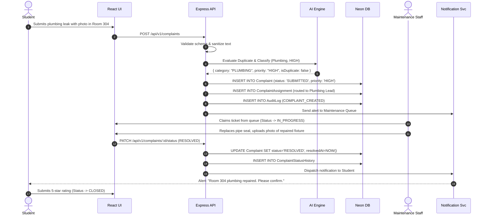
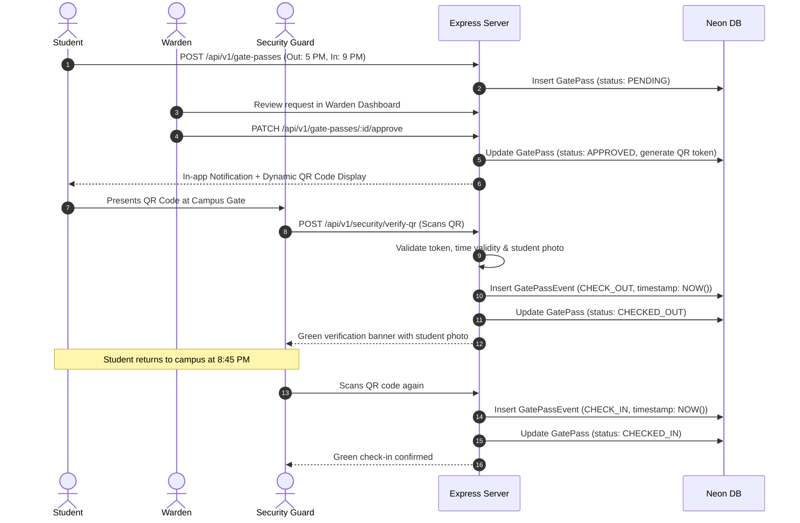

# 05 - FEATURES & BUSINESS WORKFLOW SPECIFICATIONS

## 1. Feature Specifications Matrix

### 1.1 Student Operations

#### Feature: Attendance Self-Audit
* **Purpose:** Allows students to monitor their attendance percentage per course, forecast mandatory 75% thresholds, and review missed lectures.
* **User:** Student
* **Input:** Subject filter, month selector.
* **Processing:** Aggregates `AttendanceRecord` linked to `Student` and calculates $\frac{\text{Attended Sessions}}{\text{Conducted Sessions}} \times 100$. Flags course red if $<75\%$, yellow if $75-80\%$, green if $>80\%$.
* **Output:** Percentage donut chart, subject cards, session ledger.
* **Status:** `ACTIVE`
* **Notifications:** Auto-alert triggered when attendance falls below 75%.
* **Database Entities:** `Attendance`, `AttendanceRecord`, `Subject`.
* **API Requirements:** `GET /api/v1/attendance/student/:id`

#### Feature: Gate Pass Requisition & QR Pass
* **Purpose:** Enables paperless campus exit permissions with instant Warden approval and guard check-in/out.
* **User:** Student
* **Input:** Pass Type (`DAY_OUTING`, `NIGHT_OUT`), Reason, Destination, Expected Departure and Return timestamps.
* **Processing:** Validates departure < return; checks for pending uncleared passes; queues request for Hostel Warden; generates cryptographic token on approval.
* **Output:** Digital pass card with real-time countdown and dynamic QR code.
* **Status:** `PENDING` → `APPROVED` / `REJECTED` → `CHECKED_OUT` → `CHECKED_IN` / `EXPIRED`.
* **Notifications:** Push/in-app alert to student on warden decision; SMS alert to parent for `NIGHT_OUT`.
* **Database Entities:** `GatePass`, `GatePassApproval`, `GatePassEvent`.
* **API Requirements:** `POST /api/v1/gate-passes`, `GET /api/v1/gate-passes/my-passes`.

#### Feature: Grievance Lodging (Complaints)
* **Purpose:** Eliminates hostel diaries by allowing students to log facility repairs with photo evidence and live tracking.
* **User:** Student
* **Input:** Category, Title, Description, Room/Location, Photo URL, Priority.
* **Processing:** Invokes AI classifier for priority/duplicate check, generates ticket number (`CMP-YYYY-XXXX`), calculates SLA deadline, routes to Maintenance team queue.
* **Output:** Ticket tracking page with chronological milestone stepper.
* **Status:** `SUBMITTED` → `ASSIGNED` → `IN_PROGRESS` → `RESOLVED` → `CLOSED`.
* **Notifications:** Notification to maintenance dispatch; update alerts to student on status changes.
* **Database Entities:** `Complaint`, `ComplaintStatusHistory`, `ComplaintComment`, `Attachment`.
* **API Requirements:** `POST /api/v1/complaints`, `GET /api/v1/complaints/my-complaints`.

#### Feature: Digital Certificate Requisition
* **Purpose:** Streamlines obtaining Bonafide, Study, and Fee Estimate certificates without navigating office queues.
* **User:** Student
* **Input:** Certificate Type, Purpose statement.
* **Processing:** Automatically verifies financial clearance from `FeeRecord`; assigns request to Academic Office; enables admin to attach stamped PDF.
* **Output:** Downloadable verified digital PDF document with verification QR.
* **Status:** `REQUESTED` → `UNDER_REVIEW` → `APPROVED` → `GENERATED` → `AVAILABLE`.
* **Notifications:** In-app notification when certificate is ready for download.
* **Database Entities:** `CertificateRequest`, `Certificate`, `FeeRecord`.
* **API Requirements:** `POST /api/v1/certificates`, `GET /api/v1/certificates/my-requests`.

---

### 1.2 Hostel & Facility Operations

#### Feature: Visual Room Grid & Asset Inventory
* **Purpose:** Empowers Wardens to monitor room capacity, occupancy, maintenance flags, and asset conditions.
* **User:** Warden, Maintenance, Admin
* **Input:** Hostel block selector, floor filter.
* **Processing:** Queries `Room` with joined `RoomAllocation` and `Asset` lists; aggregates active complaints by room.
* **Output:** Interactive color-coded room grid (Green: Vacant, Blue: Occupied, Amber: Partial, Red: Active Maintenance).
* **Database Entities:** `Hostel`, `HostelBlock`, `Room`, `RoomAllocation`, `Asset`.
* **API Requirements:** `GET /api/v1/hostels/:id/rooms-overview`.

---

### 1.3 Communication & Broadcasts

#### Feature: Smart Notice Dispatcher
* **Purpose:** Guarantees critical campus updates reach target cohorts with guaranteed delivery metrics.
* **User:** Admin, Faculty
* **Input:** Notice Title, Markdown Body, Category, Target Scope (`ALL`, `DEPARTMENT`, `BATCH`, `HOSTEL`), Urgency flag.
* **Processing:** Resolves target recipient IDs; inserts `Notice` and `NoticeTarget`; pushes bulk in-app notifications.
* **Output:** Published notice with analytics dashboard showing % delivered and % read.
* **Database Entities:** `Notice`, `NoticeTarget`, `NoticeRead`.
* **API Requirements:** `POST /api/v1/notices`, `GET /api/v1/notices/:id/analytics`.

---

### 1.4 Executive Command Center & Administration

#### Feature: Campus Telemetry & Recurring Issue Intelligence
* **Purpose:** Supplies campus deans and directors with unified telemetry, SLA compliance rates, and recurring failure alerts.
* **User:** Admin, Super Admin
* **Input:** Date range, department filter.
* **Processing:** Aggregates open tickets, computes mean time to resolution (MTTR), groups complaints by location/category over 30-day windows to detect chronic infrastructure failures.
* **Output:** KPI metrics, complaint ageing bar charts, recurring issue warning cards.
* **Database Entities:** All core entities.
* **API Requirements:** `GET /api/v1/analytics/overview`, `GET /api/v1/ai/recurring-issues`.

---

### 1.5 Inclusivity: Help Desk (No-Smartphone Workflow)

#### Feature: Proxy Service Desk Requisition
* **Purpose:** Ensures students without smartphones, with broken devices, or without internet access can submit complaints and gate passes.
* **User:** Help Desk Staff / Designated Student Representatives
* **Input:** Student Roll Number, Service Type (`COMPLAINT`, `GATE_PASS`, `CERTIFICATE`), Request details.
* **Processing:** Authenticates staff; fetches student identity; executes standard business logic proxying the student's ID; logs staff proxy audit trail; prints physical receipt token with barcode.
* **Output:** Printed or SMS reference token provided to student.
* **Database Entities:** `HelpDeskRequest`, `AuditLog`, Target Domain Entity.
* **API Requirements:** `POST /api/v1/help-desk/proxy-request`.

---

## 2. Detailed End-to-End Workflows

```text
STANDARD WORKFLOW LIFECYCLE TEMPLATE:
Student -> Request -> Validation -> Assignment -> Staff action -> Resolution -> Notification -> Audit trail
```

---

### Workflow 1: Hostel Maintenance Complaint



1. **Student:** Submits complaint with title, description, category, and optional photo.
2. **Request:** Client validates inputs and POSTs to `/api/v1/complaints`.
3. **Validation:** Server verifies active student enrollment and validates room location.
4. **Assignment:** AI classifies trade and priority; system auto-assigns to the relevant Maintenance Team lead.
5. **Staff Action:** Technician receives ticket, changes status to `IN_PROGRESS`, fixes the issue, and uploads resolution photo.
6. **Resolution:** Status marked as `RESOLVED`.
7. **Notification:** Real-time in-app notification sent to the student requesting satisfaction review.
8. **Audit Trail:** Immutable record written to `ComplaintStatusHistory` and `AuditLog`.

---

### Workflow 2: Academic Certificate Request

1. **Student:** Selects "Bonafide Certificate" on the portal, states purpose: "Passport Application".
2. **Request:** Submits form via `/api/v1/certificates`.
3. **Validation:** Backend verifies student has zero pending dues via `FeeRecord`.
4. **Assignment:** Request placed in Academic Section review queue.
5. **Staff Action:** Academic clerk verifies enrollment record and generates/uploads stamped PDF.
6. **Resolution:** Status transitioned to `AVAILABLE`.
7. **Notification:** Student receives push notification: *"Your Bonafide Certificate is ready to download."*
8. **Audit Trail:** Download events and approvals logged in `AuditLog`.

---

### Workflow 3: Hostel Gate Pass & Security Verification



1. **Student:** Requests Day Outing Gate Pass with destination and time window.
2. **Request:** Validates no existing overlapping active gate pass.
3. **Validation:** System checks student hostel curfew regulations.
4. **Assignment:** Appears on Hostel Warden's pending approval list.
5. **Staff Action:** Warden reviews reason and clicks "Approve".
6. **Resolution:** Cryptographic QR code generated on student's mobile screen.
7. **Security Verification:** Security guard scans QR at the gate; checkout event logged; on return, second scan completes check-in.
8. **Audit Trail:** Scan coordinates, timestamps, and guard ID recorded in `GatePassEvent`.

---

### Workflow 4: Student Hostel Leave Request
1. **Student:** Submits multi-day leave application with destination and guardian contact.
2. **Request:** Validates dates and duration.
3. **Validation:** Checks if academic examinations coincide with leave dates.
4. **Assignment:** Routes to Faculty Advisor for academic concurrence, then Hostel Warden for clearance.
5. **Staff Action:** Warden reviews parent acknowledgment and grants approval.
6. **Resolution:** Leave status updated to `APPROVED`; integrated gate pass auto-issued for departure date.
7. **Notification:** In-app and email confirmation sent to student and guardian.
8. **Audit Trail:** Multi-stage endorsements tracked in `LeaveRequest` status history.

---

### Workflow 5: Targeted Notice Publication
1. **Staff/Admin:** Authors notice in Markdown, tags target: "Computer Science - 3rd Year".
2. **Request:** POSTs payload with urgency level.
3. **Validation:** Checks author's administrative broadcasting permissions.
4. **Assignment:** System queries all enrolled students matching criteria.
5. **Staff Action:** Publisher confirms preview and clicks "Publish Now".
6. **Resolution:** Notice becomes active in student feeds immediately.
7. **Notification:** Targeted notifications dispatched to matching user accounts.
8. **Audit Trail:** Publication timestamp and audience snapshot recorded in `AuditLog`.

---

### Workflow 6: Mess Menu Feedback & Food Quality Monitoring
1. **Student:** Inspects today's lunch menu on the app after dining.
2. **Request:** Rates meal (1-5 stars) and submits qualitative ratings on hygiene and quantity.
3. **Validation:** Prevents duplicate ratings for the same meal on the same date.
4. **Assignment:** Raw feedback added to daily mess analytics aggregate.
5. **Staff Action:** Mess manager views real-time sentiment score; low ratings (<2.5) trigger instant escalation alert to Dean of Student Welfare.
6. **Resolution:** Mess committee posts corrective response note.
7. **Notification:** Monthly mess audit summary sent to student council.
8. **Audit Trail:** Anonymized feedback saved in `MessFeedback`.

---

### Workflow 7: Campus Visitor Entry Clearance
1. **Visitor/Student:** Visitor arrives at security or student pre-registers guest.
2. **Request:** Security logs visitor phone, name, photo, and student roll number being visited.
3. **Validation:** System verifies student host is currently present on campus.
4. **Assignment:** In-app confirmation prompt sent to student to confirm guest identity.
5. **Staff Action:** Guard issues digital visitor entry badge upon student's one-tap approval.
6. **Resolution:** Visitor log status set to `CHECKED_IN`; upon departure, guard records checkout.
7. **Notification:** Host student notified when guest leaves campus.
8. **Audit Trail:** Entry/exit timestamps and visitor ID proofs securely retained in `VisitorLog`.
