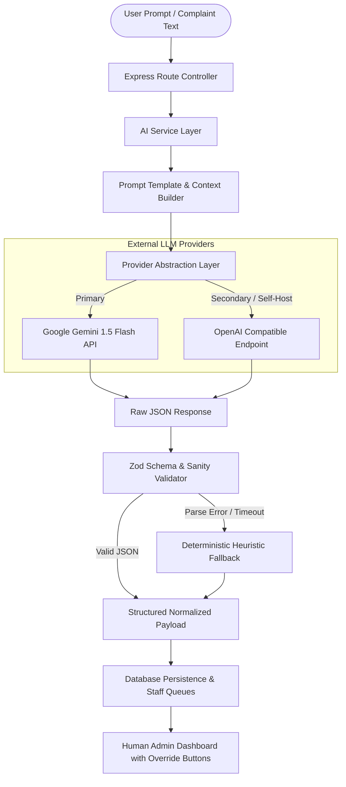

# 08 - AI SYSTEM DESIGN & INTELLIGENCE SPECIFICATION

## 1. Ethical Governance & Core Principles
1. **Human-in-the-Loop Supremacy:** AI models serve strictly as an advisory, classification, and summarization accelerator. **The AI engine is never the sole authority for punitive, academic, or disciplinary actions.** Human administrators and wardens possess absolute unilateral override capabilities across all suggestions.
2. **Zero Action Privilege:** The AI pipeline cannot directly alter student records, expel students, reject gate passes, or debit financial ledgers without explicit authenticated human authorization.
3. **Graceful Degradation & Deterministic Fallbacks:** If external AI services encounter rate-limits, network latency, or downtime, the platform gracefully defaults to rule-based heuristic algorithms without interrupting user operations.
4. **Data Isolation & Privacy:** Personal Identifiable Information (passwords, parent phone numbers, financial credentials) is scrubbed prior to model prompting.

---

## 2. High-Level AI Architecture Pipeline



---

## 3. Subsystem Specifications

### 3.1 Campus AI Assistant (RAG Pipeline)
* **Goal:** Deliver instant, accurate answers regarding college circulars, mess timings, fee schedules, and administrative workflows.
* **Architecture:**
  1. **Knowledge Base:** Curated institutional rules stored in `KnowledgeDocument`.
  2. **Context Retrieval:** Cosine keyword/vector matching selects top 3 most relevant documentation chunks.
  3. **Prompt Injection:**
     ```text
     You are the official Campus Assistant for 'Campus Life, Debugged'. 
     Use ONLY the provided institutional context to answer the student's inquiry.
     If the answer is unknown, politely direct them to the appropriate campus office.
     
     Context: {retrieved_knowledge_chunks}
     Student Query: {user_message}
     ```
  4. **Fallback:** If confidence is low or query is outside campus operational scope: *"I couldn't find a direct policy on this. Please visit the Academic Registrar or Warden's office for clarification."*

---

### 3.2 Complaint Classification & Smart Routing
* **Input:** Raw text submitted by a student (e.g., *"The ceiling fan in Room 204 started smoking and stopped spinning"*).
* **AI Output Contract (Strict JSON):**
```json
{
  "category": "ELECTRICAL",
  "department": "MAINTENANCE",
  "priority": "URGENT",
  "issueType": "EQUIPMENT_SMOKING_HAZARD",
  "location": "Hostel Room 204",
  "confidence": 0.98,
  "reasoning": "Electrical motor malfunction emitting smoke represents an active fire risk."
}
```
* **Smart Routing Logic:**
  * If `category == 'ELECTRICAL'` → Assign to Electrical Technician Trade Queue.
  * If `category == 'PLUMBING'` → Assign to Plumbing Maintenance Queue.
  * If `priority == 'URGENT'` → Trigger instant SMS/WhatsApp escalation to Hostel Warden.

---

### 3.3 Duplicate Complaint Detection
* **Purpose:** Prevents duplicate technician dispatches when multiple roommates report the same broken fixture.
* **Mechanism:**
  1. On complaint filing, system queries active open complaints (`SUBMITTED`, `ASSIGNED`, `IN_PROGRESS`) in the **same room or immediate block** within the past 7 days.
  2. Embeddings / similarity algorithm computes title & description similarity against candidates.
  3. If similarity $> 85\%$, flags complaint as:
     ```json
     {
       "isDuplicate": true,
       "duplicateOfTicket": "CMP-2026-0042",
       "similarityScore": 0.91
     }
     ```
  4. User is shown a prompt: *"A ticket (CMP-2026-0042) for this issue was already filed by your roommate Aarav 2 hours ago. Would you like to subscribe to updates instead of creating a duplicate?"*

---

### 3.4 Recurring Issue & Facility Bottleneck Intelligence
* **Purpose:** Detects systemic physical infrastructure failures across campus blocks.
* **Mechanism:**
  * Runs daily scheduled batch analysis across resolved and active complaints over 30-day windows.
  * Clusters complaints by `(categoryId, blockId, floorNumber)`.
  * **Threshold Trigger:** If $>5$ complaints of the same category occur in the same hostel block within 14 days, flags a **Recurring Issue Incident**:
    * *Example:* 14 plumbing leak complaints across 8 rooms in Hostel Block B within 10 days.
    * *Alert:* Notifies Campus Director and Chief Engineer of a probable shared pipe riser failure.

---

### 3.5 Executive Complaint Summarization
* **Purpose:** Generates concise bullet-point digests for daily morning briefings for Deans and Wardens.
* **Prompt:**
  ```text
  Summarize the following 18 maintenance tickets filed in the last 24 hours into 3 concise executive bullet points highlighting critical safety hazards and pending SLA breaches.
  ```

---

## 4. Resilience, Rate Limiting & Fallbacks

| Failure Scenario | Mitigation / Fallback Mechanism |
| :--- | :--- |
| **API Key Missing / Not Configured** | Built-in regex rule engine automatically tags keywords (e.g. "pipe", "water" -> `PLUMBING`; "fan", "spark" -> `ELECTRICAL`). |
| **Provider Timeout (> 3500ms)** | Abort signal terminates external call; defaults to `Priority: MEDIUM`, `Category: GENERAL_MAINTENANCE` with admin review tag. |
| **Malformed JSON Output** | Model outputs are stripped of markdown wrappers (` ```json `) and validated using Zod parser. If unparseable, fall back to rule engine. |
| **Rate Limit Exceeded (HTTP 429)** | In-memory exponential backoff with retry limit (2 retries). System logs warning and serves user via fallback logic without blocking request. |
