# 09 - SECURITY, ACCESSIBILITY, INCLUSIVITY & DEVOPS SPECIFICATION

---

# PART I: SECURITY & COMPLIANCE

## 1. Authentication & Authorization
* **Password Hashing:** Passwords hashed using `bcrypt` with a salt cost factor of 10. Raw passwords are never persisted or logged.
* **Stateless Tokens:** JSON Web Tokens (JWT) signed using HMAC-SHA256 (`HS256`) with a strict 7-day expiration. Secret stored strictly in `process.env.JWT_SECRET`.
* **Role-Based Access Control (RBAC):** Middleware checks `req.user.role` against permissible route enumerations (`STUDENT`, `FACULTY`, `WARDEN`, `MAINTENANCE`, `SECURITY`, `ACCOUNTS`, `ADMIN`, `SUPER_ADMIN`).
* **Object-Level Authorization:** Students can only read and mutate records belonging to their own `studentId`.

## 2. API Hardening & Middleware
* **Helmet:** Enforces secure HTTP headers (`X-Frame-Options: DENY`, `X-Content-Type-Options: nosniff`, `Strict-Transport-Security`).
* **CORS Policy:** Whitelists allowed client domains (`CLIENT_URL`). Rejects unauthorized origins with credentials support.
* **Rate Limiting:** `express-rate-limit` caps traffic to 100 requests per 15-minute sliding window per IP address, with special 10 req/15 min limit on `/api/v1/auth/login`.
* **Input Validation:** Zod and Joi schema validation intercepts every controller payload, stripping unknown keys and sanitizing malicious strings to prevent injection.

## 3. Storage & Database Security
* **SQL Injection Immunity:** Direct queries eliminated in favor of Prisma ORM's parameterized query engine.
* **SSL/TLS Encryption:** Neon PostgreSQL requires mandatory TLS connections (`sslmode=require`).
* **File Upload Protections:** Cloudinary uploads restricted to valid image MIME types (`image/jpeg`, `image/png`, `image/webp`). Files capped at 5 MB; client-side canvas compresses images prior to upload.
* **Audit Trails:** Immutable logging in `AuditLog` captures actor ID, IP address, user agent, target entity, and timestamp.

---

# PART II: ACCESSIBILITY & LOW-BANDWIDTH RESILIENCE

## 1. Web Accessibility (WCAG 2.1 AA)
* **Contrast Compliance:** All text and interactive controls maintain a contrast ratio exceeding 4.5:1 against their backgrounds.
* **Keyboard Navigability:** Full keyboard operability (`Tab`, `Shift+Tab`, `Enter`, `Escape`) with visible focus rings (`ring-2 ring-primary-500`).
* **Screen Reader Optimization:** Form elements paired with explicit `<label>` tags; icons wrapped with `aria-hidden="true"`; dynamic alerts decorated with `role="alert"`.
* **Touch Target Ergonomics:** Mobile buttons and interactive elements maintain minimum dimensions of $48 \times 48\text{ px}$.

## 2. Low-Bandwidth & Dead Zone Engineering
* **PWA (Progressive Web App):** Installable web application configured via `manifest.json`.
* **Service Worker Caching:**
  * Core JS/CSS app shell served via Cache-First strategy.
  * Static educational schedules and personal profile data cached for offline review.
* **Data Optimization:**
  * Gzip/Brotli compression enabled on all Express responses.
  * API endpoints implement pagination (default limit: 20).
  * Payloads avoid nested deep joins; send only necessary UI fields.
* **Offline Fallback:** Clean `offline.html` page displayed when network is unavailable, with continuous reconnect pinging.

## 3. Inclusivity: The Help Desk (No-Smartphone Workflow)
Not all students possess high-end smartphones or uninterrupted data packs. The **Campus Help Desk** module bridges this digital divide:

```mermaid
flowchart LR
    Student([Student without Phone]) -->|Visits Counter| Desk[Physical Help Desk]
    Desk --> Staff[Authorized Help Desk Staff]
    Staff --> Terminal[Help Desk Web Terminal /help-desk]
    Terminal -->|Enters Student Roll No| API[Proxy Request API /api/v1/help-desk/proxy-request]
    API --> System[Unified Campus Engine]
    System --> Token[Generated Reference Token & Barcode]
    Token --> Printout[Physical Paper Slip Handed to Student]
```


* **Workflow:**
  1. Student presents their physical Student ID card at the Help Desk.
  2. Staff inputs the Roll Number; the system renders the student's photo and verification details.
  3. Staff selects the request type (e.g., Gate Pass or Maintenance Complaint).
  4. System executes the request, tagging `HelpDeskRequest` with `staffId` and `studentId`.
  5. The student receives a physical printed token or SMS with a tracking barcode.

## 4. Multi-Lingual Architecture (i18n)
* **Supported Languages:** English (`en`), Hindi (`hi`), Odia (`or`).
* **Implementation:** Keyed dictionary resource files (`client/src/locales/{en,hi,or}.json`).
* **Persistent Preference:** User language choice stored in `localStorage` and optionally synchronized with `User.languagePreference`.

---

# PART III: DEVOPS, CONTAINERIZATION & CLOUD DEPLOYMENT

## 1. Docker Architecture

### 1.1 Backend Dockerfile (`server/Dockerfile`)
```dockerfile
FROM node:20-alpine AS builder
WORKDIR /app
COPY package*.json ./
RUN npm ci --only=production
COPY prisma ./prisma/
RUN npx prisma generate
COPY . .

FROM node:20-alpine AS runner
WORKDIR /app
ENV NODE_ENV=production
COPY --from=builder /app/node_modules ./node_modules
COPY --from=builder /app/prisma ./prisma
COPY --from=builder /app/src ./src
COPY --from=builder /app/package.json ./package.json

EXPOSE 5000
CMD ["node", "src/server.js"]
```

### 1.2 Docker Compose Configuration (`docker-compose.yml`)
```yaml
version: '3.8'

services:
  server:
    build:
      context: ./server
      dockerfile: Dockerfile
    ports:
      - "5000:5000"
    environment:
      - PORT=5000
      - NODE_ENV=production
      - DATABASE_URL=${DATABASE_URL}
      - JWT_SECRET=${JWT_SECRET}
      - CLIENT_URL=${CLIENT_URL}
      - AI_PROVIDER=${AI_PROVIDER}
      - AI_API_KEY=${AI_API_KEY}
    restart: unless-stopped
```

*(Note: Neon PostgreSQL is a serverless managed cloud database and is accessed externally via `DATABASE_URL`; it is not hosted inside the local Docker network).*

---

## 2. Vercel Deployment for Frontend
* **Build Command:** `npm run build`
* **Output Directory:** `dist`
* **Routing Configuration (`vercel.json`):**
```json
{
  "rewrites": [
    { "source": "/(.*)", "destination": "/index.html" }
  ]
}
```
* **Environment Variables:** `VITE_API_URL` pointing to the live production server URL.

---

## 3. Git Workflow & Branching Strategy
* **`main`:** Production-grade, verified releases. Auto-deploys to production environments.
* **`develop`:** Staging and integration branch.
* **`feature/*`:** Isolated branches for domain tasks (`feature/auth`, `feature/student`, `feature/complaints`, `feature/ai`).

---

## 4. GitHub Actions CI/CD Pipeline (`.github/workflows/ci.yml`)
```yaml
name: Continuous Integration & Verification

on:
  push:
    branches: [ main, develop ]
  pull_request:
    branches: [ main ]

jobs:
  verify:
    runs-on: ubuntu-latest
    steps:
      - name: Checkout repository
        uses: actions/checkout@v4

      - name: Setup Node.js 20
        uses: actions/setup-node@v4
        with:
          node-version: 20
          cache: 'npm'

      - name: Install Root Dependencies
        run: npm ci || npm install

      - name: Validate Server Syntax & Build
        run: |
          cd server
          npm ci || npm install
          npx prisma generate

      - name: Build React Client (Vite)
        run: |
          cd client
          npm ci || npm install
          npm run build
```

---

## 5. Health Checks & Telemetry Monitoring
* **Health Check Route:** `GET /health` returns `{ "status": "UP", "timestamp": "...", "database": "CONNECTED" }`.
* **Structured Logging:** Morgan logger configured for HTTP telemetry; errors output with stack traces in development and sanitized JSON in production.
